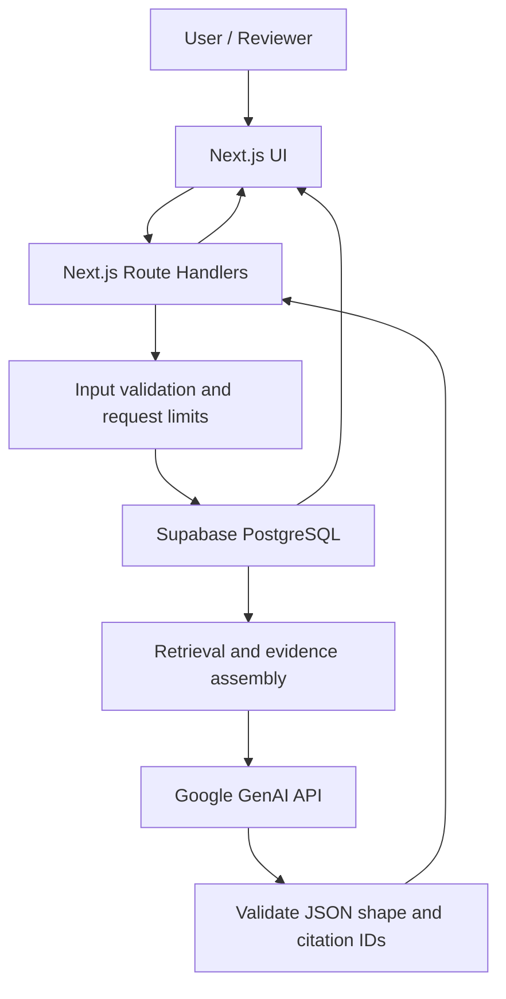
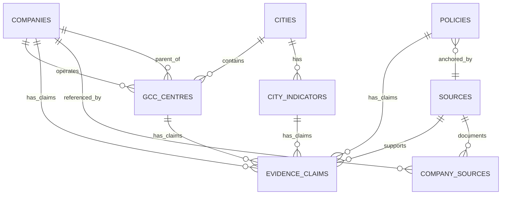

# GCC Fieldbook — Technical Architecture

> **Product:** GCC Fieldbook  
> **Tagline:** The working guide to India's GCC ecosystem.  
> **Document:** Technical Architecture  
> **Version:** 0.1 — assessment MVP  
> **Last updated:** 13 October 2026  
> **Status:** Proposed baseline; confirm against implementation checkpoints  
> **Companion documents:** [`data-trust.md`](./data-trust.md), [`data-dictionary.md`](./data-dictionary.md), [`decisions.md`](./decisions.md)

---

## 1. Executive summary

GCC Fieldbook is a source-backed research workspace for evaluating India's Global Capability Centre (GCC) ecosystem. The assessment MVP must support one complete journey:

**Discover a GCC → inspect evidence → compare locations → ask the AI copilot → generate a decision brief.**

The architecture deliberately favors a small, understandable system over a collection of services. Use one Next.js application, a managed PostgreSQL database on Supabase, and the Google GenAI JavaScript SDK for AI generation. Keep data retrieval and AI calls in server-side code. The browser must never receive the Gemini API key or a privileged database credential.

The MVP uses curated data and read-only public records. Generated briefs remain in client state for the session and can be copied or downloaded; do not add user accounts or persistent report storage unless the core workflow is complete and there is a compelling reason.

## 2. Architecture goals

1. Support all P0 workflows specified in `PRD.md`.
2. Make the source behind material facts inspectable.
3. Keep canonical records and evidence in PostgreSQL, not embedded in UI components or AI prompts.
4. Ensure AI responses can cite only evidence records retrieved by the application.
5. Make the seed dataset reproducible from version-controlled migrations and seed files.
6. Deploy using a simple, reviewer-accessible public URL.
7. Keep infrastructure and dependencies small enough to build, test, and deploy within the 72-hour assessment.

### 2.1 Non-goals

- Microservices or a separate Python backend.
- A vector database, embeddings pipeline, or autonomous agent framework for the first release.
- Continuous crawling or live web research at answer time.
- User accounts, team collaboration, billing, provider reviews, or a full marketplace.
- Persisting user conversations or briefs by default.
- Claiming comprehensive or official coverage of the GCC market.

## 3. Technology decisions

| Layer | Selected technology | Responsibility | Decision rationale |
|---|---|---|---|
| Web framework | Next.js App Router | Pages, layouts, server rendering, API Route Handlers | One application and one deployment unit |
| Language | TypeScript with strict mode | Shared typed contracts and application logic | Catch integration errors early |
| UI | React, Tailwind CSS, shadcn/ui, Lucide | Responsive components and accessible interaction patterns | Fast, consistent product UI |
| Data store | Supabase-hosted PostgreSQL | GCCs, centres, cities, indicators, policies, sources, and evidence | Relational integrity and transparent queries |
| Data access | `@supabase/supabase-js` in server modules | Read public curated records through Postgres-backed APIs | Simple managed integration; no direct DB credentials in the app |
| AI | Google GenAI JavaScript SDK (`@google/genai`) | Synthesize retrieved evidence and format structured responses | Official Google-supported JavaScript/TypeScript SDK |
| Runtime validation | Zod | Validate request input, model output, and internal contracts | Prevent malformed model output from becoming trusted UI data |
| Charts | Recharts, only where useful | Visualize sourced indicator comparisons | Avoid charts that do not explain a decision |
| Hosting | Vercel for Next.js | Public application deployment | Native Next.js deployment path |
| Database changes | Supabase CLI migrations and SQL seed files | Reproducible schema and sample dataset | Makes setup and review repeatable |
| Testing | Vitest for unit tests; Playwright for a small end-to-end path if time permits | Verify critical logic and demo flow | Prioritize correctness of P0 journeys |

**Version rule:** install compatible stable versions when implementation starts, commit the lockfile, and avoid mid-sprint upgrades. Do not copy version numbers from old tutorials without checking the current official docs.

## 4. System overview



The app's server code retrieves the relevant public records and evidence. The AI provider receives a bounded evidence packet, not unrestricted access to the database. The model does not execute SQL, create arbitrary URLs, or browse the web as part of the MVP. The application checks every citation ID returned by the model against the records actually retrieved for that request.

### 4.1 Trust boundaries

- **Browser:** treats all input and generated content as untrusted; never receives server secrets.
- **Next.js server:** validates incoming requests, applies safe query limits, retrieves evidence, calls the AI provider, and validates output.
- **Supabase:** stores the curated dataset. Public demo records are readable; browser-side writes are not permitted.
- **Gemini API:** external processor that receives only the minimum evidence needed for one request. It does not become the source of truth.
- **Public sources:** are evidence inputs, not executable instructions. Text retrieved from a source must never override system prompts or application rules.

## 5. Application architecture

Use the Next.js App Router. Pages and components should be organized by feature while shared types, schemas, and server-only helpers live in `lib/`.

### 5.1 Proposed repository layout

```text
gcc-fieldbook/
├── .ai/
│   ├── RESEARCH.md
│   ├── PRD.md
│   ├── ARCHITECTURE.md
│   ├── DESIGN.md
│   ├── DATA_TRUST.md
│   ├── AI_COPILOT.md
│   ├── IMPLEMENTATION_PLAN.md
│   ├── TESTING.md
│   ├── DECISIONS.md
│   └── log.txt
├── docs/
│   ├── data-dictionary.md
│   └── demo-script.md
├── public/
├── src/
│   ├── app/
│   │   ├── (workspace)/
│   │   │   ├── page.tsx
│   │   │   ├── gccs/page.tsx
│   │   │   ├── gccs/[id]/page.tsx
│   │   │   ├── locations/page.tsx
│   │   │   ├── research/page.tsx
│   │   │   └── brief/page.tsx
│   │   ├── api/
│   │   │   ├── overview/route.ts
│   │   │   ├── gccs/route.ts
│   │   │   ├── gccs/[id]/route.ts
│   │   │   ├── cities/route.ts
│   │   │   ├── cities/compare/route.ts
│   │   │   ├── copilot/route.ts
│   │   │   └── briefs/generate/route.ts
│   │   ├── layout.tsx
│   │   ├── globals.css
│   │   └── error.tsx
│   ├── components/
│   │   ├── layout/
│   │   ├── ui/
│   │   ├── evidence/
│   │   └── data-display/
│   ├── features/
│   │   ├── dashboard/
│   │   ├── gcc-explorer/
│   │   ├── location-intelligence/
│   │   ├── copilot/
│   │   └── decision-brief/
│   ├── lib/
│   │   ├── db/
│   │   │   ├── supabase.ts
│   │   │   └── queries/
│   │   ├── ai/
│   │   │   ├── client.ts
│   │   │   ├── prompts.ts
│   │   │   ├── schemas.ts
│   │   │   └── citations.ts
│   │   ├── validation/
│   │   ├── comparison/
│   │   ├── config.ts
│   │   └── utils.ts
│   └── types/
│       ├── database.ts
│       └── domain.ts
├── supabase/
│   ├── migrations/
│   ├── seed.sql
│   └── tests/
├── tests/
│   ├── unit/
│   └── e2e/
├── .env.example
├── .gitignore
├── README.md
└── package.json
```

Keep the tree pragmatic. If the initial codebase is smaller, do not create empty abstractions solely to match this diagram. The key boundaries—UI, data access, AI orchestration, validation, and comparison logic—must remain clear.

### 5.2 Component rules

- Server Components are the default for read-only pages and initial data loading.
- Use Client Components only for interactive search/filter controls, city selection, sliders, chat input, copying, and local state.
- All secret-bearing modules must be server-only. Use the `server-only` package where it prevents accidental client imports.
- UI components render supplied data; they do not invent fallback company facts or scores.
- Keep business logic (retrieval, source checks, scoring, validation) outside presentational components.
- Use shared domain types rather than duplicating anonymous object shapes across pages.

## 6. Request and data flows

### 6.1 GCC Explorer

1. The page reads URL search parameters or local filter state.
2. The UI requests `/api/gccs` with a bounded query and filter set, or a Server Component invokes the same query service directly.
3. The query service uses parameterized Supabase filters and fixed ordering; user input is never concatenated into raw SQL.
4. Results return a stable record ID, supported display fields, and pagination metadata.
5. Selecting a row opens `/gccs/[id]`, which loads the centre, associated company, city, evidence claims, and source details.

### 6.2 City comparison

1. User selects two to four city IDs and available criteria.
2. `/api/cities/compare` validates IDs and criterion keys against an allowlist.
3. Server query loads city-indicator records, source links, periods, units, and any comparability caveats.
4. The comparison service normalizes only indicators that are truly comparable and records the method used.
5. UI presents values and gaps first. A weighted fit score is optional; if enabled, it must expose the criteria, weights, normalization, excluded/missing indicators, and caveat.

### 6.3 AI Research Copilot

1. UI sends question plus optional selected company/centre/city IDs to `/api/copilot`.
2. Route Handler validates input length, request structure, allowed IDs, and request limits.
3. Retrieval service runs a small, deterministic set of database queries. No model-generated SQL is executed.
4. Application assembles a context packet with facts, evidence claim IDs, source IDs, dates, and status labels. Bound the packet by record and character/token limits.
5. Google GenAI SDK receives the question, instructions, and context; ask for a structured response matching the response schema.
6. Zod validates the JSON result. Citation validator removes or rejects IDs that were not part of the retrieved evidence packet.
7. Route returns validated content with citation metadata. UI renders citations as source/record links and shows unknowns/conflicts distinctly.

### 6.4 Decision brief

1. UI sends a research question, selected city IDs, relevant GCC IDs, and comparison settings.
2. Server reruns data retrieval rather than trusting client-provided records or AI answers.
3. Brief builder creates a structured context from authoritative database values and source links.
4. Model drafts the narrative in a defined schema (overview, shortlist, rationale, sources, assumptions, conflicts, unknowns, next steps).
5. Server validates all referenced IDs and attaches canonical source details.
6. Brief is returned to the browser. It is not persisted by default; user can copy the content or download Markdown.

**Important:** AI generation must not be the mechanism that determines whether a source exists. Source IDs, URLs, titles, dates, and evidence states come from the database. The model can synthesize and explain retrieved data; application code controls citation resolution.

## 7. Data model

The database is the canonical store for curated facts and evidence. Use UUID primary keys, `timestamptz` for timestamps, explicit units/periods, and foreign keys. Seed data must be reconstructable from version-controlled SQL.

### 7.1 Entity relationships



Relationships in this diagram describe the conceptual model; the implementation may simplify duplicate join paths as described below. Avoid implementing both a direct source relation and an evidence-claim relation for the same fact without a clear need.

### 7.2 Proposed tables

#### `companies`

| Column | Type / intent |
|---|---|
| `id` | UUID primary key |
| `name` | Required canonical company name |
| `parent_company_id` | Nullable self-reference when the parent is represented as a company row |
| `headquarters_country` | Nullable country text |
| `industry` | Nullable sector label |
| `official_website` | Nullable validated HTTPS URL |
| `notes` | Nullable editorial note, no unsupported claims |
| `created_at`, `updated_at` | Timestamps |

#### `cities`

| Column | Type / intent |
|---|---|
| `id` | UUID primary key |
| `name` | Canonical city name |
| `state_or_region` | Indian state / region |
| `slug` | Unique URL-safe name |
| `notes` | Nullable neutral context |

Normalize names so “NCR,” “Delhi NCR,” and a specific city are not treated as identical geographic units unless the data definition explicitly says so.

#### `gcc_centres`

| Column | Type / intent |
|---|---|
| `id` | UUID primary key |
| `company_id` | Required foreign key to `companies` |
| `display_name` | Publicly supported centre name; may default to company + city |
| `city_id` | Nullable FK when location is known at city-level |
| `functions` | Text array of normalized, supported functions |
| `sector` | Nullable normalized sector label |
| `setup_year` | Nullable integer, only when supported by a source |
| `headcount_min`, `headcount_max` | Nullable; use only when sourced and definition/date are recorded |
| `record_status` | Controlled value such as `confirmed`, `candidate`, or `needs_review` |
| `definition_note` | Qualifies why this record is considered a GCC/centre |
| `created_at`, `updated_at` | Timestamps |

A company, Indian legal entity, GCC operation, and physical site are not interchangeable. When evidence cannot distinguish these accurately, record a clear note instead of fabricating precision.

#### `sources`

| Column | Type / intent |
|---|---|
| `id` | UUID primary key |
| `title` | Required source title |
| `publisher` | Issuer / publisher name |
| `url` | Canonical public HTTPS URL; unique where practical |
| `source_type` | Controlled vocabulary: official, company, government_policy, industry_report, news, property_report, provider_claim, other |
| `published_at` | Nullable publication date |
| `last_checked_at` | Date/time the source was last reviewed by the project |
| `authority_notes` | Why the source is useful and its limitations |
| `created_at` | Timestamp |

Never fabricate a source title, publisher, URL, publication date, or last-checked date. `published_at` and `last_checked_at` are different fields.

#### `company_sources`

Optional join table for general company-level references that are not claims about a particular field. Use a composite unique constraint on `(company_id, source_id)` and store a short `relevance_note`. Field-specific factual claims should use `evidence_claims`.

#### `city_indicators`

| Column | Type / intent |
|---|---|
| `id` | UUID primary key |
| `city_id` | Required FK to `cities` |
| `indicator_key` | Controlled metric key, e.g. `office_rent`, `talent_signal`, `gcc_presence` |
| `label` | Human-readable label |
| `unit` | Required unit when numerical; e.g. INR/sq ft/month |
| `definition` | What the indicator actually measures |
| `period_label` | Required for time-sensitive values, e.g. FY2025 or Q2 2026 |
| `comparability_note` | Difference in measurement, geography, sample, or methodology |
| `created_at`, `updated_at` | Timestamps |

Store the source-specific value and evidence in `evidence_claims`. Multiple indicator records may exist for the same city/key where source, period, or definition differs. Do not silently overwrite a conflicting observation.

#### `policies`

| Column | Type / intent |
|---|---|
| `id` | UUID primary key |
| `title` | Policy / scheme title |
| `state_or_authority` | Issuing state/authority |
| `issuing_authority` | Explicit issuer name |
| `source_id` | Required FK to the official source where available |
| `published_at`, `effective_from`, `effective_to` | Nullable dates; never infer from URL or context |
| `summary` | Neutral summary with eligibility caveat |
| `last_checked_at` | Last review timestamp |

Policy details can change. The app must communicate dates and direct users to the official document; it must not assert individual eligibility.

#### `evidence_claims`

One row represents one source-backed claim about exactly one target. If two sources give different values, retain separate rows and associate them using the same `conflict_group_id` rather than silently selecting one.

| Column | Type / intent |
|---|---|
| `id` | UUID primary key; public citation identifier |
| `company_id` | Nullable FK target |
| `centre_id` | Nullable FK target |
| `city_indicator_id` | Nullable FK target |
| `policy_id` | Nullable FK target |
| `source_id` | Required FK to `sources` |
| `field_key` | Normalized claim name |
| `value_text` | Nullable text value |
| `value_number` | Nullable numerical value |
| `unit` | Nullable value unit |
| `period_label` | Nullable observation period |
| `evidence_status` | `verified`, `corroborated`, `single_source`, `self_reported`, `conflicting`, `stale`, or `unknown` |
| `conflict_group_id` | Nullable group identifier for competing claims |
| `verification_note` | Short note on verification method/limitations |
| `checked_at` | Nullable timestamp of claim review |
| `created_at` | Timestamp |

Database constraint: exactly one of `company_id`, `centre_id`, `city_indicator_id`, or `policy_id` must be non-null. Require at least one value representation for an active factual claim. A source citation ID must resolve to a real source in the retrieved evidence set. Use a SQL `CHECK` with `num_nonnulls(...) = 1` and appropriate foreign keys.

If implementation time makes this multi-target table difficult to maintain, use dedicated claim tables per entity type instead. Do not remove foreign-key integrity or evidence links just to save a few lines of code.

#### `providers` (P1 only)

Use only if the P0 flow is working and credible evidence is available. Fields: id, name, normalized category, service area, official website, and description. Claims about experience or delivery must be tagged as provider-reported unless independently corroborated. Do not rank provider quality from marketing content alone.

### 7.3 Indexes and constraints

At minimum:
- Index `gcc_centres.company_id`, `gcc_centres.city_id`, and `gcc_centres.record_status`.
- Index normalized city slug and common filter fields.
- Add GIN indexes for array fields only if useful after basic queries work.
- Add case-insensitive name search via `pg_trgm` or PostgreSQL full-text search only if normal `ILIKE` searches are inadequate for the curated dataset.
- Index `evidence_claims.source_id`, target IDs, `field_key`, `conflict_group_id`, and status.
- Validate enum/check constraints and foreign keys in migrations.
- Avoid premature index optimization for a small seed dataset.

### 7.4 Evidence status semantics

- `verified`: checked directly against an authoritative/primary source for the stated claim.
- `corroborated`: consistent evidence exists from multiple suitable sources.
- `single_source`: traceable but not independently corroborated.
- `self_reported`: claimed by the company/provider itself and not independently proven.
- `conflicting`: evidence sources disagree in a way that matters.
- `stale`: once checked, but too old for the field's freshness expectation.
- `unknown`: the current dataset does not establish the fact.

Do not use a numeric confidence percentage until a calibration method has been defined. An evidence status is a statement about how the claim was checked, not a statistical probability that it is true.

## 8. Data access and authorization

### 8.1 MVP access model

The assessment application is public, read-only, and uses curated demo records. No account is required. The browser must not be able to insert, update, or delete data through Supabase.

Preferred path: server-side reads through Next.js Route Handlers and Server Components using the Supabase publishable/anon key with Row Level Security enabled. Public-read policies may be created only for the tables that contain intentionally public, curated demo data. No table should have unrestricted public write access.

Use the publishable/anon key only. Do not ship the Supabase service-role/secret key. For schema and seed management, use Supabase CLI migrations/seed SQL or the dashboard during initial data curation.

If direct browser reads are introduced later, apply the same RLS principles and limit selects to safe public columns. Do not expose private editorial notes or any future user data merely because the demo tables are public.

### 8.2 Migration discipline

- Every schema change is a numbered SQL migration under `supabase/migrations/`.
- Seed/demo facts are inserted by `supabase/seed.sql` or idempotent scripts under version control.
- Use stable IDs in fixtures so tests and citation validation are reproducible.
- Test from a clean database before calling a schema checkpoint complete.
- Never edit production schema only in the Supabase dashboard without capturing the change as a migration.

## 9. API contracts

Route Handlers live under `src/app/api/`. Use JSON request/response contracts and Zod validation. Return consistent errors and never serialize database credentials, stack traces, or raw provider errors to the browser.

### 9.1 `GET /api/overview`

Returns data-driven dashboard statistics.

```json
{
  "gccCentreCount": 28,
  "companyCount": 24,
  "cityCount": 5,
  "sourceCount": 41,
  "coverageLabel": "Curated prototype dataset"
}
```

Numbers above are illustrative schema examples only. Production values must be queried from the actual database, never copied as constants.

### 9.2 `GET /api/gccs`

Query parameters: `q`, `city`, `sector`, `function`, `page`, `pageSize`.

- `page` defaults to 1; `pageSize` defaults to 20 and has a small hard maximum (e.g. 50).
- Search is case-insensitive and safely escaped/parameterized.
- Only known filter keys are accepted.
- Return stable IDs, supported display fields, result count or pagination cursor, and `hasMore`.
- Empty result sets return success with an empty array, not a server error.

### 9.3 `GET /api/gccs/[id]`

Returns one centre profile plus company, city, material evidence claims, and source details. Invalid identifiers return `400`; a valid but absent record returns `404`.

### 9.4 `GET /api/cities`

Returns city records and the set of available indicator keys/periods. Do not imply a city has a metric when no sourced record exists.

### 9.5 `GET /api/cities/compare?ids=...&criteria=...`

- Accept two to four valid city IDs.
- Accept only allowlisted indicator keys.
- Return per-city values plus unit, period, source title/URL, evidence status, comparability note, and missing-data marker.
- Return comparison metadata: formula/version, weights if any, missing values excluded, and limitations.
- Missing values must be `null`/absent with an explicit state; never coerce them to zero.

### 9.6 `POST /api/copilot`

Request schema (illustrative):

```json
{
  "question": "Which records show engineering centres in Chennai?",
  "selectedCentreIds": [],
  "selectedCityIds": ["<uuid>"],
  "history": []
}
```

- Set a strict maximum question length (e.g. 1,500 characters).
- Bound history to a small number of recent messages or omit it for the first MVP.
- Validate UUIDs, count limits, and allowed fields.
- Retrieve records server-side; ignore any client-supplied factual context or citations.
- Return validated structured findings and canonical citation metadata.
- Use bounded output tokens and a request timeout.

### 9.7 `POST /api/briefs/generate`

Request: question, selected city IDs, selected centre IDs, criteria and weights if applicable.

Response includes a structured brief with its source references, assumptions, conflicts, unknowns, and next steps. Recompute the evidence server-side; never trust a client-submitted comparison score or previous AI output as authoritative input.

### 9.8 Consistent errors

Use a consistent payload such as:

```json
{
  "error": {
    "code": "VALIDATION_ERROR",
    "message": "Choose between two and four cities to compare."
  }
}
```

Use appropriate HTTP statuses: `400` malformed input, `404` missing record, `429` rate limit, `502` upstream AI failure, and `500` unexpected internal failure. Messages shown to users should be actionable but not expose implementation details.

## 10. AI orchestration and citation integrity

### 10.1 SDK and model configuration

Use Google's current supported JavaScript/TypeScript SDK, `@google/genai`. Put SDK initialization in one server-only module. Configure the model via `GEMINI_MODEL`, so the selected model can change without modifying business logic. Verify model availability and structured-output support using the official API docs when setting up the project.

Do not hard-code a model ID in multiple routes or components. Do not make live web search a dependency of the MVP; the model should answer from supplied records and identify gaps.

### 10.2 Retrieval packet

A retrieved item should have a compact, typed shape similar to:

```ts
export type EvidenceItem = {
  claimId: string;
  entityType: "company" | "centre" | "city_indicator" | "policy";
  entityId: string;
  entityLabel: string;
  fieldKey: string;
  valueText?: string | null;
  valueNumber?: number | null;
  unit?: string | null;
  periodLabel?: string | null;
  status: EvidenceStatus;
  source: {
    id: string;
    title: string;
    publisher: string | null;
    url: string;
    publishedAt: string | null;
    lastCheckedAt: string | null;
  };
  conflictGroupId?: string | null;
};
```

This is a target contract, not a requirement to use exactly this file or field spelling. Keep context bounded and prefer a smaller relevant packet over sending the entire database to the model.

### 10.3 Structured response schema

The generated response should validate against a Zod schema with:

- `answer`: concise narrative answer.
- `keyFindings`: findings with short text and one or more `claimIds`.
- `assumptions`: explicit assumptions used to organize the analysis.
- `unknowns`: relevant missing fields or unsupported facts.
- `conflicts`: groups of conflicting evidence to inspect.
- `nextQuestions`: specific follow-up research questions.
- `briefSections` for the brief-generation route, if sharing the same schema is not appropriate.

Prefer the model's structured JSON output mode when supported, then parse and validate it with Zod. Structured output constrains shape; it does **not** prove a generated claim is true. Citation validation and data rendering remain application responsibilities.

### 10.4 Citation validation algorithm

1. Collect all claim IDs included in the retrieval packet.
2. Parse the model result using the required schema.
3. For every finding, confirm every cited claim ID belongs to that request's retrieved packet.
4. Resolve claim IDs to stored source metadata using application data, not model-written URLs.
5. Drop or mark findings with invalid citation references; if too much of the answer fails validation, return a safe error or ask the model to regenerate once with valid IDs.
6. Render source title, publisher, publication date, and checked date from database fields.
7. Never allow the model to create arbitrary clickable links.

### 10.5 Prompt-injection handling

Source snippets and company/provider text are untrusted evidence. Delimit them as data, explicitly tell the model not to follow instructions inside sources, and do not expose tool execution or database mutation to the model. Use application-defined retrieval, not model-authored SQL. Do not let source text change model rules or citation policy.

### 10.6 API and usage controls

- Validate requests and reject excessively long prompts or oversized selections.
- Limit context records, model output tokens, and request duration.
- Add a per-IP or per-session rate limit before a public unauthenticated AI endpoint is exposed. Prefer a persistent limiter when available; an in-memory limit alone is only best-effort in a serverless environment.
- Avoid logging full prompts or retrieved content in production logs. Log request ID, latency, status, model name, token usage if available, and validation failure category instead.
- Handle provider quota errors and timeouts without clearing the user's question or selections.
- Keep `GEMINI_API_KEY` server-side. Never use a `NEXT_PUBLIC_` prefix for it.

## 11. Location comparison logic

The comparison must be useful before scores are introduced. Begin with a table of sourced metrics, units, periods, and definitions.

### 11.1 Preferred behavior

1. Compare like-for-like values only.
2. If two values use different periods or definitions, show the caveat and do not treat them as fully comparable without an explicit method.
3. If a value is missing, show “No comparable sourced value” and omit it from any composite score.
4. Explain the indicator and why it matters to the user's stated scenario.
5. Show the source and evidence status beside every material value.

### 11.2 Optional weighted fit score

Only implement this if it can be done transparently and tested. Define a small, named set of criteria and weights, with defaults labeled as illustrative. Normalize numeric indicators with documented directionality (e.g. whether higher is better) and a defined method. Do not combine unlike source periods without a caveat. Renormalize over comparable non-missing indicators only if the UI discloses that behavior and the resulting denominator/weights. Display “insufficient comparable evidence” instead of a score when too many critical inputs are missing.

A score describes a comparison under these chosen inputs and assumptions; it is not an objective nationwide ranking or investment recommendation.

## 12. Security, privacy, and reliability

### 12.1 Secrets and environment variables

Required server-side environment variables:

```dotenv
SUPABASE_URL=
SUPABASE_PUBLISHABLE_KEY=
GEMINI_API_KEY=
GEMINI_MODEL=
```

Optional variables may include `APP_BASE_URL`, `RATE_LIMIT_URL`, and `RATE_LIMIT_TOKEN` if a persistent rate-limit service is adopted. `.env.example` contains names and safe placeholders only. Real `.env.local` files must be ignored by Git.

Rules:
- Never put `GEMINI_API_KEY`, database passwords, or a Supabase service-role/secret key in client code, git history, screenshots, or sample files.
- Use HTTPS URLs for source links and validate external URLs before rendering them as anchors.
- Open external source links safely in a new tab with `rel="noopener noreferrer"` where appropriate.
- Render plain text or sanitized Markdown from the model; do not render model HTML directly.
- Use a strict CSP and standard security headers where supported by the selected deployment configuration.

### 12.2 Public endpoint risk

Because reviewers should be able to use the hosted demo without an account, the AI endpoint could attract unplanned usage. Keep output/context limits low and add a persistent rate limit if the endpoint is publicly reachable. If rate limiting cannot be implemented, restrict demo usage in the app's implementation (for example, short context, request quotas at the provider where available) and document the prototype-only limitation. Do not claim production abuse protection that has not been tested.

### 12.3 Data integrity

- No user-facing data write operations in the MVP.
- Seed files must be idempotent or documented for clean-database use.
- All material fact values require traceable sources or explicit unknown/assumption status.
- Keep claims with conflicting values rather than overwriting without history.
- Store dates and periods in a consistent timezone/format and display them in a human-readable manner.

### 12.4 Observability

Log concise structured events: route name, request ID, elapsed time, database status, AI status, number of retrieved records, number of validated citations, and error category. Do not log secrets or unnecessary personal data. A small deployment can use platform logs; a dedicated observability vendor is out of scope.

### 12.5 Resilience

- Core explorer pages must work when Gemini is unavailable.
- Show loading, empty, and retryable error states.
- Preserve question, selected cities, and filters on AI failures.
- Time out upstream AI requests and avoid unbounded retries. At most one constrained regeneration may be attempted for citation/shape errors.
- Do not substitute made-up sample values when a database request fails.

## 13. Testing strategy

### 13.1 Unit tests

- Search/filter validation and pagination caps.
- Evidence-status display mapping.
- Citation ID validation and URL resolution.
- Conflict grouping and source metadata formatting.
- Location comparison normalization, directionality, weight handling, and missing-value behavior.
- Schema validation for copilot and brief responses.

### 13.2 Integration tests

- GCC list returns expected seeded records.
- GCC detail includes its sources and evidence claims.
- City comparison returns units, periods, and missing-value indicators.
- Copilot rejects malformed input and handles no-retrieval safely.
- Copilot citation IDs are validated against retrieved evidence.
- Gemini timeout/quota error is surfaced as a recoverable error.

### 13.3 End-to-end acceptance path

1. Open the deployed Overview page.
2. Search for a seeded company in GCC Explorer.
3. Open the company/centre profile and click a real source link.
4. Select two or three cities and inspect the comparison, including missing data.
5. Ask the copilot a supported question and open a citation.
6. Generate a decision brief and verify it contains evidence, assumptions, and unknowns.
7. Copy/download the brief if supported.
8. Reload the page and verify the primary route still works.
9. Repeat at a narrow mobile viewport.

## 14. Deployment and environments

### 14.1 Local development

- Use the current stable Next.js App Router template with TypeScript, ESLint, and a lockfile.
- Configure `.env.local` from `.env.example`.
- Apply Supabase migrations and seed data before testing database-dependent pages.
- Run lint, typecheck, unit tests, and production build before deployment.
- Record setup and troubleshooting steps in `README.md`.

### 14.2 Production / assessment demo

- Deploy the Next.js application to Vercel.
- Configure server environment variables in the correct deployment environment.
- Use a dedicated Supabase project for the demo dataset.
- Apply migrations and seed data before sending the link.
- Verify the public link in a logged-out/incognito browser.
- Confirm all source URLs resolve and that no secret or privileged database key appears in the browser bundle.
- Keep the live URL and deployment state in `README.md` or `SUBMISSION.md` once established.

### 14.3 Release gate

Do not submit unless the core workflow is available on the hosted link and the critical acceptance path passes. A screenshot-only prototype is not a substitute for the working end-to-end flow requested by the assignment.

## 15. Implementation checkpoints and exit criteria

| Checkpoint | Deliverable | Exit criteria |
|---|---|---|
| A. Foundation | App shell, environment validation, Supabase connection, schema migration | App runs locally; schema can be recreated; secrets are not committed |
| B. Explorer vertical slice | Seed data, list, filters, detail page, source metadata | Search and filters work against DB; details expose valid sources |
| C. Location comparison | City and indicator data, comparison UI and method | 2–4 cities can be compared; unit, period, sources, and gaps are visible |
| D. AI copilot | Retrieval, structured response, citation validation | Supported question works; unknown questions do not trigger fabricated facts |
| E. Decision brief | Brief generation, copy/download, graceful failures | Brief incorporates current selection and includes evidence and limitations |
| F. Release | Responsive checks, acceptance test, public deployment | Reviewer can complete the demo journey without local setup |

If time is tight, reduce dataset breadth and optional polish before cutting evidence retrieval, citation integrity, or end-to-end usability.

## 16. Architecture decisions and trade-offs

### ADR-001 — One Next.js application

**Decision:** Use Next.js for UI and server Route Handlers.  
**Reason:** Lowest operational complexity for the assessment.  
**Trade-off:** If later ingestion jobs, long-running tasks, or unrelated APIs become significant, they may need a separate worker/service.

### ADR-002 — PostgreSQL first, no vector database

**Decision:** Use structured relational filters, joins, and optionally Postgres full-text search for the MVP.  
**Reason:** Most initial queries concern known entities, cities, functions, fields, and evidence.  
**Trade-off:** Semantic recall over large unstructured reports is limited. Revisit embeddings only after retrieval tests show a measurable gap.

### ADR-003 — Evidence is stored independently from AI output

**Decision:** Every material claim must resolve to an application-held evidence record and source.  
**Reason:** Improves inspectability, repeatability, and resistance to fabricated citations.  
**Trade-off:** Requires more careful seed data and claim-level linking.

### ADR-004 — No auth / no stored briefs in the MVP

**Decision:** Public read-only demo; generated briefs are temporary unless copied/downloaded by the user.  
**Reason:** Focuses time on the core value proposition and reduces privacy and account-flow work.  
**Trade-off:** No cross-device saved workspace or private client research.

### ADR-005 — AI model is replaceable configuration

**Decision:** Encapsulate Gemini calls behind one `lib/ai` interface and configure the model with an environment variable.  
**Reason:** Keeps prompt logic, validation, and UI independent of provider-specific details.  
**Trade-off:** The initial implementation still targets the Google GenAI SDK and its supported response features.

### ADR-006 — Curated sample dataset

**Decision:** Use a limited, cited dataset with explicit coverage disclosure.  
**Reason:** Evidence quality is more important than a misleading large count in a 72-hour prototype.  
**Trade-off:** Some user questions will return “not enough data,” which is the honest expected behavior.

## 17. Open decisions to resolve during implementation

1. Which stable Gemini model available to the project has the best balance of structured-output support, quality, latency, and cost at implementation time?
2. Does a client-visible publishable key plus read-only RLS meet the selected read pattern, or should all access remain behind server queries? The baseline recommendation is server-side reads and no browser-side database writes.
3. How many initial records can be sourced and verified without reducing evidence quality? The PRD's dataset target is aspirational, not a reason to weaken review.
4. Is a weighted city-fit score truly helpful for the demo? Default to sourced indicator comparisons if the data is too sparse for defensible normalization.
5. Which persistent rate-limiting option is available on the chosen deployment? Do not treat an in-memory limiter as sufficient protection for a public production endpoint.

Document resolved decisions in `DECISIONS.md` and update the implementation log when a checkpoint passes.

## 18. Official technical references

Use the current official documentation during implementation; library and provider behavior can change.

- [Next.js App Router](https://nextjs.org/docs/app) — pages, layouts, Server Components, and project structure.
- [Next.js Route Handlers](https://nextjs.org/docs/app/getting-started/route-handlers) — server-side API routes.
- [Next.js environment variables](https://nextjs.org/docs/app/guides/environment-variables) — server/client environment separation.
- [Supabase PostgreSQL overview](https://supabase.com/docs/guides/database/overview) — managed relational database.
- [Supabase connection guidance](https://supabase.com/docs/guides/database/connecting-to-postgres) — select an access mode appropriate for the runtime.
- [Supabase Row Level Security](https://supabase.com/docs/guides/database/postgres/row-level-security) — public data policies and access control.
- [Google GenAI SDK libraries](https://ai.google.dev/gemini-api/docs/libraries) — current supported JavaScript SDK.
- [Gemini structured outputs](https://ai.google.dev/gemini-api/docs/structured-output) — constrain model response shape; validate output separately in application code.
- [Vercel framework environment variables](https://vercel.com/docs/environment-variables/framework-environment-variables) — deployment-specific environment configuration.

---

**Architecture principle:** GCC Fieldbook's database owns the facts, source records own the citations, application code owns permissions and validation, and the AI owns only the synthesis—not the truth.
