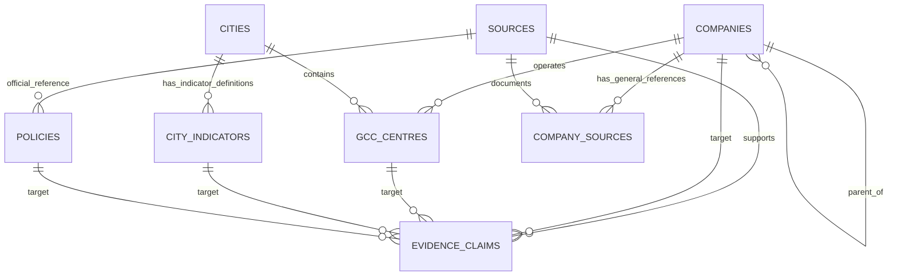

# GCC Fieldbook — Data Dictionary

> **Product:** GCC Fieldbook  
> **Tagline:** The working guide to India's GCC ecosystem.  
> **Document:** Canonical field definitions for the assessment MVP  
> **Version:** 0.1  
> **Status:** Implementation reference; reconcile any schema change with `.ai/ARCHITECTURE.md` and `.ai/DECISIONS.md`  
> **Last updated:** 13 October 2026

## 1. Purpose

This dictionary defines the meaning, expected type, nullability, controlled values, relationships, and display rules for the data stored by GCC Fieldbook. It exists so that product code, migrations, seed data, tests, the AI copilot, and the UI use the same interpretation of a field.

The PostgreSQL database is the canonical store for curated facts and source metadata. The language model is not a database and its generated wording is not a canonical fact. Material factual claims should be traceable to individual `evidence_claims` records and their `sources` records.

Read this document with:

- [`../.ai/PRD.md`](../.ai/PRD.md) — product scope and user-facing requirements.
- [`../.ai/ARCHITECTURE.md`](../.ai/ARCHITECTURE.md) — system boundaries, proposed tables, constraints, and API flows.
- [`../.ai/DATA_TRUST.md`](../.ai/DATA_TRUST.md) — source quality, claim verification, conflicting evidence, and freshness semantics.
- [`../.ai/AI_COPILOT.md`](../.ai/AI_COPILOT.md) — evidence packet and citation contracts.
- [`../.ai/TESTING.md`](../.ai/TESTING.md) — validation and release tests.
- [`../.ai/DECISIONS.md`](../.ai/DECISIONS.md) — durable implementation decisions.

**Precedence:** `PRD.md` governs product scope; `DATA_TRUST.md` governs evidence meaning; `ARCHITECTURE.md` governs physical database architecture. This dictionary explains the fields in those documents. If a field or relationship needs to change, update the relevant source document and record the change in `DECISIONS.md` before silently changing the schema.

## 2. Domain vocabulary

| Term | Definition | Must not be confused with |
|---|---|---|
| Company | A parent or operating company represented as a canonical organization record. | An individual GCC centre, an Indian legal entity, or a physical office. |
| Parent company | The parent organization, represented by `companies.parent_company_id` when a separate record exists. | A free-text guess based only on a brand name. |
| GCC centre | An evidence-supported India-based capability operation or centre associated with a company. | Every office, subsidiary, sales branch, or engineering job posting. |
| City | A normalized geographic unit used for location discovery and comparison. | A broad region such as NCR unless the record expressly defines that region. |
| City indicator | A definition of a measure used to compare cities, such as an office rent benchmark for a stated period. | A bare numeric value without its unit, period, geography, or definition. |
| Source | A public document or webpage from which a claim may be assessed. | The claim itself or proof that every field on a profile is true. |
| Evidence claim | One source-backed observation about one target and one field. | A whole company profile or an AI-generated paragraph. |
| Evidence status | A controlled description of how one specific claim is supported. | A global quality score for an entire company. |
| Observation period | The time period that a value describes, such as FY2025 or Q2 2026. | The date a researcher checked the source. |
| Published date | The date the publisher issued the source, if explicitly available. | `last_checked_at`, the date GCC Fieldbook reviewed it. |
| Last checked | The last time a researcher reviewed the source or claim. | The source publication date or the date the underlying value applies to. |
| Provider | A service business that supports GCC establishment or operation; an optional P1 entity. | A provider's self-promotional claim being independently proven. |

### 2.1 GCC classification rule

Only create a `confirmed` centre when suitable evidence supports that the operation performs capabilities for a parent/global business or is explicitly described as a GCC, global capability centre, global in-house centre, or equivalent. A company's Indian incorporation or local office alone is not sufficient. Where evidence is suggestive but insufficient, use `candidate` or `needs_review` and keep it out of confirmed counts by default.

### 2.2 One company may have multiple centres

Represent a parent/company and an India-based centre separately. A company can have multiple centres or locations. Do not collapse the parent company, India legal entity, GCC operation, and physical office into one record just to simplify the interface. If sources do not establish the right granularity, use a clear `definition_note` and review the classification rather than fabricating precision.

## 3. Database conventions

| Convention | Rule |
|---|---|
| Primary keys | Use PostgreSQL `uuid` primary keys, generated by `gen_random_uuid()` or a consistent repository-approved default. Seed files may use fixed UUIDs for reproducibility. |
| Foreign keys | Enforce with actual database `FOREIGN KEY` constraints; application validation is additional, not a substitute. |
| Timestamps | Use `timestamptz` for event/audit timestamps. Store instants consistently and render in the user's locale; the product's operating timezone is `Asia/Kolkata`. |
| Dates | Use `date` for effective-from/effective-to dates and other day-level dates when no time-of-day is meaningful. |
| Names | Preserve a readable display name and use normalized values/slugs only for search, matching, and stable routes. |
| Text | Trim whitespace. Store no fabricated filler such as `N/A`, `0`, `Unknown Company`, or `TBD` in a factual field. Represent missing values as SQL `NULL` and display an explicit UI state. |
| Numeric values | Never store formatted values such as `"₹120–₹150"` in a numeric column. Store a numeric value and a separate unit, period, or min/max pair. Preserve reported ranges when the source gives a range. |
| Units | Store a human-readable, controlled unit token when the value is quantitative, e.g. `INR/sq_ft/month`, `people`, or `percent`. Document any conversion. |
| Periods | Use `period_label` for a source-defined label, such as `FY2025`, `Q2 2026`, or `as reported on 2026-09-30`. Do not infer a period when the source does not supply one. |
| Source URLs | Store only a real, inspectable public URL that was checked. Do not generate URLs from a title or company slug. Prefer canonical HTTPS URLs. |
| Provenance | Store source metadata separately from a specific claim. A source attached to one claim must not be displayed as support for all facts on that entity. |
| Seed data | Every material factual seed claim must be traceable to a source. Migrations and seed files must be version-controlled and reproducible. |
| Client exposure | Only expose fields intended for public, read-only display. Never expose secret keys, raw internal credentials, private notes containing sensitive data, or privileged database operations. |

### 3.1 Controlled values vs. free text

Where a field is used for filters, counts, validation, or UI status, use a controlled vocabulary or stable key. Free-text notes may add nuance, but they must not be used as the only representation of a field that needs reliable filtering.

### 3.2 Missing, unknown, and zero

- `NULL` means the database does not have a value for that field.
- `0` is a factual numeric value and must only be used when the source establishes zero.
- An empty string must not be used to mean unknown.
- `unknown`, `not_disclosed`, `not_found`, and `not_applicable` have different meanings; do not interchange them.
- The UI should normally derive `Not established in available sources` when no qualifying claim exists. Do not invent an `evidence_claims` row or fake source just to render an unknown status.
- If an explicit record of a missingness review becomes necessary, add a deliberately designed missingness model rather than overloading a factual evidence claim. Record such a schema change in `DECISIONS.md`.

## 4. Entity relationship overview

The conceptual MVP model is:



`company_sources` is optional for general references that do not support a field-level assertion. The `evidence_claims` table is the primary link between material facts and evidence. Do not introduce redundant source links on every entity merely because a source is present in the database.

The base architecture does **not** define a standalone aggregate-market-statistics table. Do not store an India-wide GCC total in an unrelated city indicator or policy row. If the MVP needs first-class, queryable historical market statistics, first record the schema change in `DECISIONS.md` and update `ARCHITECTURE.md`, `DATA_TRUST.md`, and the claim-target constraints together. Until then, market-count comparisons may only be shown from a deliberately documented, source-backed structure that actually supports those claims; do not force-fit them into this schema.

## 5. Table dictionary

The tables below define the recommended logical contract. Physical SQL types, indexes, checks, and foreign keys must be implemented in migrations. If repository inspection finds an existing schema that materially differs, reconcile before implementation instead of silently diverging.

### 5.1 `companies`

**Purpose:** Canonical organization records for multinational parent companies and operating companies.

| Column | PostgreSQL type | Required? | Meaning / validation |
|---|---|---:|---|
| `id` | `uuid` | Yes | Primary key. Stable identifier used by API routes and related records. |
| `name` | `text` | Yes | Canonical organization name; non-empty after trimming. Preserve the most defensible public name. |
| `parent_company_id` | `uuid` | No | Self-referencing FK to `companies.id` when the parent is represented separately. Must not point to itself. |
| `headquarters_country` | `text` | No | Country associated with the company's headquarters, only when known. Do not infer from a brand name. |
| `industry` | `text` | No | Normalized broad industry/sector label for search/filtering. Keep controlled values documented in seed/type code. |
| `official_website` | `text` | No | Validated public HTTPS URL for the official company site. Do not use search-result URLs or third-party directory URLs in this field. |
| `notes` | `text` | No | Short neutral editorial note. Do not store unsupported market claims here as if they were verified. |
| `created_at` | `timestamptz` | Yes | Row creation timestamp. Default to `now()`. |
| `updated_at` | `timestamptz` | Yes | Last row update timestamp. Keep in sync via application logic or a database trigger. |

**Constraints and indexes**

- Primary key on `id`.
- Foreign key `parent_company_id → companies.id` with a deliberate delete behavior; do not cascade-delete child companies that have centre records without an explicit need.
- `CHECK (parent_company_id IS NULL OR parent_company_id <> id)`.
- Index `lower(name)` or use a search extension only if ordinary search needs improvement.
- Do not assume `name` is globally unique. If aliases or same-name entities appear, add an explicit deduplication/identity strategy before imposing an unsafe uniqueness rule.

**Display rule:** Company facts should link to evidence claims where material. A company record itself is an identity record, not blanket verification of every attribute.

### 5.2 `cities`

**Purpose:** Canonical geographic units for GCC-centre locations and city comparison.

| Column | PostgreSQL type | Required? | Meaning / validation |
|---|---|---:|---|
| `id` | `uuid` | Yes | Primary key. |
| `name` | `text` | Yes | Canonical city/market display name. Non-empty. |
| `state_or_region` | `text` | Yes | Indian state/union territory or carefully defined region associated with the city/market. |
| `slug` | `text` | Yes | Unique URL-safe identifier, lowercase and hyphen-separated. Stable after release where practical. |
| `notes` | `text` | No | Neutral geographic or scope note; may explain when a record represents a broader market. |

**Constraints and indexes**

- Unique index on `slug`.
- Index on `lower(name)` if used for search.
- Use a canonical taxonomy. Do not treat `Delhi`, `NCR`, and `Delhi NCR` as identical geography unless the market scope is expressly defined and normalized.
- If a region such as NCR is represented, identify it as a metro/market scope in notes or a future explicit geography-type field. Do not imply it is an administrative city.

### 5.3 `gcc_centres`

**Purpose:** Records of evidence-supported GCC operations/centres associated with a company and, where known, a city.

| Column | PostgreSQL type | Required? | Meaning / validation |
|---|---|---:|---|
| `id` | `uuid` | Yes | Primary key and stable centre record identifier. |
| `company_id` | `uuid` | Yes | FK to `companies.id`. A centre must have an associated canonical company record. |
| `display_name` | `text` | Yes | Source-supported public name. If no official centre name exists, use a cautious label such as `Company — Chennai centre` and do not imply it is an official name. |
| `city_id` | `uuid` | No | FK to `cities.id` when the source supports the city/market assignment. Nullable when location is not established at that granularity. |
| `functions` | `text[]` | Yes | Normalized list of supported functions, e.g. `software_engineering`, `data_analytics`, `ai_ml`. Use an empty array only if the implementation explicitly means no function has been established; UI should show `Not established`, not `No functions`. |
| `sector` | `text` | No | Centre-specific sector or specialization if supported; don't automatically copy `companies.industry` if the centre has a narrower function. |
| `setup_year` | `integer` | No | Year the relevant centre/operation was set up, only when a source supports it. Must be a plausible four-digit year, not a year guessed from an announcement. |
| `headcount_min` | `integer` | No | Lower bound of a sourced headcount range, when available. Non-negative and definition/date must be documented through the evidence claim. |
| `headcount_max` | `integer` | No | Upper bound of a sourced headcount range. Must be greater than or equal to `headcount_min` when both are present. |
| `record_status` | `text`/enum | Yes | Inclusion/classification state: `confirmed`, `candidate`, or `needs_review`. Keep this separate from claim-level evidence status. |
| `definition_note` | `text` | No | Explains classification, scope, or ambiguity such as whether evidence refers to an operation, campus, or individual site. |
| `created_at` | `timestamptz` | Yes | Row creation timestamp. |
| `updated_at` | `timestamptz` | Yes | Row update timestamp. |

**Constraints and indexes**

- Foreign keys to `companies` and `cities`.
- `CHECK (setup_year IS NULL OR setup_year BETWEEN 1900 AND 2100)`; adapt the upper bound only through an intentional schema change.
- `CHECK (headcount_min IS NULL OR headcount_min >= 0)` and the same for `headcount_max`.
- `CHECK (headcount_min IS NULL OR headcount_max IS NULL OR headcount_max >= headcount_min)`.
- `CHECK (record_status IN ('confirmed','candidate','needs_review'))` if not using a PostgreSQL enum.
- Index `company_id`, `city_id`, `record_status`; add indexes for frequently queried sector/function only after confirming query patterns.

**Counting rule:** Dashboard confirmed-centre counts should include only records classified `confirmed`, unless the UI visibly includes candidates and explains the definition. Do not count a company with multiple centres as one centre or vice versa without labeling the metric being counted.

### 5.4 `sources`

**Purpose:** Canonical registry of public materials used to assess claims.

| Column | PostgreSQL type | Required? | Meaning / validation |
|---|---|---:|---|
| `id` | `uuid` | Yes | Primary key; this is the canonical `sourceId` for API responses. |
| `title` | `text` | Yes | Actual page/report/document title. Do not invent or reconstruct it from a URL. |
| `publisher` | `text` | Yes | Organization, publisher, authority, or company that issued the material. Use `Unknown publisher` only if the source has genuinely been checked and remains unidentified, preferably with a note; do not use it as a shortcut. |
| `url` | `text` | Yes | Real, inspected public URL. Prefer canonical HTTPS. Validate URL syntax; use a unique constraint where practical but allow explicit canonicalization decisions for equivalent URLs. |
| `source_type` | `text`/enum | Yes | Controlled type (see Section 6.1). |
| `published_at` | `timestamptz` | No | Publication timestamp/date when actually available. If only a date is published, store a date-derived instant consistently or change the column to `date` before migrations are frozen; do not invent a time. |
| `last_checked_at` | `timestamptz` | Yes | When a researcher last reviewed that source. Must not be copied from the publication date. |
| `authority_notes` | `text` | No | Briefly explains relevance, authority, caveats, geography, or methodological limitations. |
| `created_at` | `timestamptz` | Yes | Row creation timestamp. |

**Constraints and indexes**

- Primary key on `id`.
- `source_type` must match the controlled list in Section 6.1.
- Validate the URL as a public HTTP(S) URL in application code and restrict to HTTPS unless an exceptional source genuinely requires otherwise. Do not fetch arbitrary user-submitted URLs in the MVP.
- Index `source_type` and `last_checked_at` if used in source filters/freshness views.

**Date rule:** `published_at` tells when the source was published; `last_checked_at` tells when the project last inspected it. These values are not interchangeable.

### 5.5 `company_sources` (optional relationship table)

**Purpose:** Links a company to a general source that provides context about that company but is not being used for a single field-level claim.

| Column | PostgreSQL type | Required? | Meaning / validation |
|---|---|---:|---|
| `company_id` | `uuid` | Yes | FK to `companies.id`. |
| `source_id` | `uuid` | Yes | FK to `sources.id`. |
| `relevance_note` | `text` | No | Explains the general relevance, not a replacement for a field-level claim. |
| `created_at` | `timestamptz` | Yes | Link creation timestamp. |

**Constraints:** composite primary key or unique constraint on `(company_id, source_id)`. Use this for general references only. If the source supports a factual city, function, setup year, or headcount statement, create an `evidence_claims` row for that assertion.

### 5.6 `city_indicators`

**Purpose:** Defines a comparable metric for a city. The schema separates the metric definition from source-specific observed values, which live in `evidence_claims`.

| Column | PostgreSQL type | Required? | Meaning / validation |
|---|---|---:|---|
| `id` | `uuid` | Yes | Primary key; a particular indicator definition. |
| `city_id` | `uuid` | Yes | FK to `cities.id`. |
| `indicator_key` | `text` | Yes | Stable machine key, e.g. `office_rent`, `talent_signal`, `gcc_presence`. Controlled keys are documented in Section 7. |
| `label` | `text` | Yes | Human-readable indicator name. |
| `unit` | `text` | No | Standard unit for numeric value(s), required when a value is numeric. Examples: `INR/sq_ft/month`, `people`, `percent`, `count`. |
| `definition` | `text` | Yes | What is measured, including geography and inclusion rules when relevant. |
| `period_label` | `text` | No | Expected/defined observation period, e.g. `FY2025`, when specific to the indicator definition. The claim may carry its own period if sources vary. |
| `comparability_note` | `text` | No | Explain limitations where sources differ by sample, geography, time window, method, or definition. |
| `created_at` | `timestamptz` | Yes | Row creation timestamp. |
| `updated_at` | `timestamptz` | Yes | Row update timestamp. |

**Important:** `city_indicators` is not the table for storing one universal value per city. Multiple claims can describe the same indicator over different periods or using different source methods. The observation/value and provenance belong in `evidence_claims`.

**Constraints and indexes**

- FK to `cities.id`.
- Index `(city_id, indicator_key)`.
- Do not impose uniqueness on `(city_id, indicator_key)` if legitimate observations can differ by definition, period, or benchmark. If the actual seed model needs multiple indicator definitions, keep them separate and explain comparability.

### 5.7 `policies`

**Purpose:** Records a government policy, incentive scheme, or official program relevant to GCC establishment or operation.

| Column | PostgreSQL type | Required? | Meaning / validation |
|---|---|---:|---|
| `id` | `uuid` | Yes | Primary key. |
| `title` | `text` | Yes | Official or clearly labeled policy/scheme title. |
| `state_or_authority` | `text` | Yes | State or scope of the issuing authority, e.g. a specific state or central government. |
| `issuing_authority` | `text` | Yes | Named government department/authority that issued the policy. |
| `source_id` | `uuid` | Yes for an active policy record | FK to `sources.id`, preferably an official primary source. Do not create an active policy record without an inspectable policy source. |
| `published_at` | `date` or `timestamptz` | No | Publication date if explicitly available; use one consistent schema type chosen in migrations. |
| `effective_from` | `date` | No | Effective-from date, only as published. |
| `effective_to` | `date` | No | Effective-to/expiry date, only as published. Null does not mean a policy remains active indefinitely. |
| `summary` | `text` | Yes | Neutral summary of what the policy says, with caveats and a clear separation between published conditions and interpretations. |
| `last_checked_at` | `timestamptz` | Yes | Last review date for the policy/source status. |

**Constraints and display rules**

- FK to `sources.id`.
- If both effective dates exist, `effective_to >= effective_from`.
- Label outdated or unconfirmed status when the policy has not been rechecked; do not infer current validity from an old document.
- Do not assert that a specific company qualifies for an incentive without applying the official criteria with adequate evidence and appropriate professional review. GCC Fieldbook provides research, not legal or tax advice.

**Implementation note:** Architecture currently leaves some date column types flexible at the proposal stage. Choose a consistent final type during migration design and update this dictionary and `ARCHITECTURE.md` together before freezing schema.

### 5.8 `evidence_claims`

**Purpose:** The central provenance model. One row represents one specific observation/assertion for one target, supported by one source. Different sources supporting the same field produce separate rows; contradictory values must remain separately inspectable.

| Column | PostgreSQL type | Required? | Meaning / validation |
|---|---|---:|---|
| `id` | `uuid` | Yes | Primary key and canonical `claimId` used by copilot response contracts. |
| `company_id` | `uuid` | Conditionally | FK to `companies.id`; exactly one target FK across this row's target columns must be non-null. |
| `centre_id` | `uuid` | Conditionally | FK to `gcc_centres.id`; exactly one target FK must be non-null. |
| `city_indicator_id` | `uuid` | Conditionally | FK to `city_indicators.id`; exactly one target FK must be non-null. |
| `policy_id` | `uuid` | Conditionally | FK to `policies.id`; exactly one target FK must be non-null. |
| `source_id` | `uuid` | Yes | FK to `sources.id`; must reference the source supporting this specific observation. |
| `field_key` | `text` | Yes | Stable assertion key, e.g. `city_presence`, `function`, `setup_year`, `headcount`, `office_rent`, `policy_effective_date`. Use a controlled key list in code where possible. |
| `value_text` | `text` | Conditionally | Text representation of a non-numeric observation or the original reported wording when this matters. Do not duplicate a formatted numeric value here unless preserving the source's exact wording is intentional and clear. |
| `value_number` | `numeric` | Conditionally | Numeric observation. Use `numeric`, not a floating-point type, for business figures that require stable decimal representation. |
| `unit` | `text` | No | Unit for the numeric value or quantified observation. Use a normalized, documented token. |
| `period_label` | `text` | No | Period/time scope the value refers to, e.g. `FY2025`, `Q2 2026`, `as of 2026-09-30`. |
| `evidence_status` | `text`/enum | Yes | Controlled status from Section 6.2. Status describes this claim, not the whole entity. |
| `conflict_group_id` | `uuid` | No | Shared identifier for materially competing claims. Use the same value for claims in one dispute; null for unrelated claims. |
| `verification_note` | `text` | No | Brief method/limitation note: what was checked, what remains uncertain, or why sources are not directly comparable. |
| `checked_at` | `timestamptz` | No | When this specific claim was last reviewed. It can differ from `sources.last_checked_at` when a source has several claims. |
| `created_at` | `timestamptz` | Yes | Claim row creation timestamp. |

**Required constraints**

1. Foreign keys must reference their corresponding target and `sources`.
2. Exactly one target field among `company_id`, `centre_id`, `city_indicator_id`, and `policy_id` must be non-null. In PostgreSQL, this can be enforced with `CHECK (num_nonnulls(company_id, centre_id, city_indicator_id, policy_id) = 1)`.
3. A factual claim row must contain a meaningful `value_text` or `value_number` as appropriate. A row with both null values must not masquerade as an established fact.
4. `value_number` should not be used as a storage slot for an arbitrary confidence percentage or unsupported score.
5. If `evidence_status = 'conflicting'`, a `conflict_group_id` should normally be present; if two records only have minor differences in scope, do not mark them as a conflict without an explanatory note.
6. For `verified`, `corroborated`, `single_source`, `self_reported`, `conflicting`, and `stale`, keep the source inspectable and status defensible. Do not assign `corroborated` merely because the same press release was syndicated by multiple sites.
7. For a missing fact, prefer no claim row plus an explicit UI missing state. The allowed `unknown` status may be useful for an explicitly reviewed claim record, but do not create a value-less factual row unless a deliberate missingness model and SQL constraint have been implemented and documented.

**Claim atomicity rule:** Keep each claim narrow enough that its supporting source clearly establishes the assertion. For example, an announcement that a company opens an engineering centre and hires 300 people should normally become at least two claims: one about centre/location presence and another about headcount, because the facts may have different definitions, dates, and verification status.

**Source linkage rule:** `source_id` identifies the source attached to a claim. `claimId` identifies the observation. API responses may include both IDs and the source metadata resolved by the server. The model may propose claim/source IDs only from the evidence packet it receives; server-side validation must reject any unknown IDs.

### 5.9 `providers` (optional P1 only)

**Purpose:** Basic service-provider profiles, added only after the core GCC discovery-to-decision workflow is working and the available data is credible.

Suggested fields if activated: `id` (`uuid`), `name` (`text`), `category` (`text`), `service_area` (`text` or normalized array), `official_website` (`text`), `description` (`text`), `created_at` and `updated_at` (`timestamptz`).

- Treat provider-written profiles and case studies as `self_reported` unless independently corroborated.
- Provider delivery outcomes and experience statements must be expressed as individual evidence claims if the schema is extended to target providers.
- **Current schema limitation:** `evidence_claims` as defined in `ARCHITECTURE.md` does not include `provider_id` as a target. Before launching evidence-backed provider search, extend the target model and exactly-one-target constraint together in `ARCHITECTURE.md`, this dictionary, and relevant tests. Do not pretend providers have the same first-class claim support until that change is made.
- Do not rank provider quality from marketing copy or create public delivery-reputation scores without defensible, comparable evidence.

## 6. Controlled vocabularies

Controlled values should be declared once in TypeScript/Zod and enforced in PostgreSQL where the value is persisted. Avoid slightly different spellings between database, API, AI prompt, and UI.

### 6.1 `sources.source_type`

| Value | Use when | Notes |
|---|---|---|
| `official` | Official company/institution page or primary material not better categorized below. | For company primary statements, `company` may be more precise. |
| `company` | Company-owned announcement, official corporate page, investor material, or company-published report. | Strong for the company's own statements; not necessarily an independent comparison source. |
| `government_policy` | Government policy, scheme, notification, or official state/central guidance. | Use official issuer when available. |
| `industry_report` | Identifiable industry-body or research-firm report. | Preserve date, definitions, methodology, and source notes. |
| `news` | Reputable news report with an identifiable publisher and inspectable content. | Seek primary sources for consequential claims where practical. |
| `property_report` | Identifiable commercial real-estate/property research. | Preserve period, market definition, unit, and methodology. |
| `provider_claim` | Service provider's own website, case study, or marketing material. | Treat performance statements as self-reported unless corroborated. |
| `other` | Source not covered above but still usable after review. | Explain why it is appropriate in `authority_notes`. |

Search snippets, unattributed AI output, scraped data with unclear provenance, and unsourced social posts should be treated as research leads rather than cited as sole evidence for material factual claims.

### 6.2 `evidence_claims.evidence_status`

| Value | Meaning | UI label idea | Key caution |
|---|---|---|---|
| `verified` | Checked against a suitable primary/authoritative source or documented verification rule. | Verified | Means this specific claim was checked—not that the entire profile is verified. |
| `corroborated` | Two or more sufficiently independent suitable sources support substantially the same claim. | Corroborated | Independent sources must not merely repeat the same press release. |
| `single_source` | One inspectable source supports the claim, but no independent corroboration is recorded. | Single source | Does not automatically mean poor evidence. |
| `self_reported` | The assertion comes from the subject/provider's own marketing, page, profile, or case study. | Self-reported | Do not present as independent delivery proof. |
| `conflicting` | Suitable sources disagree materially or use different definitions that affect the answer. | Conflicting evidence | Preserve claims and explain dates/definitions rather than silently selecting one. |
| `stale` | A previously checked claim exceeds the field's freshness rule or is known to be outdated. | Needs re-check | Define freshness by field; do not apply one arbitrary expiry to every record. |
| `unknown` | An explicit record has been reviewed but the value is not established. | Unknown | For P0, normally derive this display state from absence of a supported claim instead of inserting a value-less claim. |

This is a support-status taxonomy, not a numeric probability that a claim is true. Do not render an arbitrary `92% confidence` badge without a documented and validated calibration method.

### 6.3 `gcc_centres.record_status`

| Value | Meaning | Count behavior |
|---|---|---|
| `confirmed` | Inclusion criteria for a GCC/centre are supported by credible evidence. | Included in confirmed centre counts. |
| `candidate` | Evidence suggests a possible GCC/centre, but inclusion is not established. | Excluded from confirmed counts by default. |
| `needs_review` | A record exists but classification, scope, duplicate identity, or source support needs manual review. | Excluded from confirmed counts by default. |

`record_status` controls whether the record qualifies as a centre in the dataset. `evidence_status` controls the support state of a single claim. Do not substitute one field for the other.

### 6.4 Data absence terms

Use the following UI copy carefully; these are display semantics, not all database enum values:

- **Not established in available sources:** the current curated dataset does not support the value.
- **Not disclosed:** a suitable source was reviewed and the subject did not disclose the value, or explicitly states it is not disclosed.
- **Not found in this review:** the documented search/review did not locate the value. This does not mean no disclosure exists anywhere.
- **Not applicable:** the field does not meaningfully apply to the entity.
- **Conflicting evidence:** at least two material claims disagree or describe non-comparable definitions.

Avoid `N/A` when the intended meaning is ambiguous.

## 7. Recommended controlled keys

### 7.1 Function keys for `gcc_centres.functions`

Use normalized lowercase identifiers (snake_case). The initial list may include:

- `software_engineering`
- `ai_ml`
- `data_analytics`
- `cybersecurity`
- `product_design`
- `product_management`
- `finance`
- `hr`
- `business_operations`
- `customer_support`
- `sales_operations`
- `research_and_development`
- `supply_chain`
- `legal_compliance`

Only include functions supported by a source. The list is extensible through a controlled change. A new source phrase should map to a canonical key only when the meaning is equivalent; preserve qualifiers in a claim or note where necessary. Do not infer `ai_ml` from a general software-engineering centre.

### 7.2 Indicator keys for `city_indicators.indicator_key`

Initial candidates, enabled only if source data is available:

| Key | Intended meaning | Important units/notes |
|---|---|---|
| `office_rent` | Commercial office rental benchmark. | INR/sq ft/month or the report's actual unit; record grade, submarket, and period where available. |
| `talent_signal` | Sourced measure indicating availability or concentration of a defined talent group. | Must define whether this is job postings, workforce count, supply proxy, or another metric. Do not label a proxy as total available talent. |
| `gcc_presence` | A source-backed count/measure of GCCs or centres in a defined geography. | Must state whether the measure counts companies, centres, units, or campuses and cite the counting methodology. |
| `salary_benchmark` | Salary estimate for a defined role/level and period. | Currency, annual/monthly basis, sample, seniority, and source period are mandatory to interpret it. P0 only if reliable sources are available. |
| `infrastructure_signal` | A specifically defined infrastructure measure. | A vague qualitative rating needs a documented rubric; do not use generic unsupported scores. |
| `industry_specialization` | Evidence of sector or function concentration. | May be categorical/textual; define the underlying basis rather than implying an official ranking. |

Never create values for a city just so a comparison table is fully populated. The comparison service must show gaps and only compare genuinely comparable observations.

### 7.3 Claim `field_key` examples

Possible keys include `headquarters_country`, `industry`, `city_presence`, `function`, `setup_year`, `headcount`, `centre_name`, `office_rent`, `talent_signal`, `gcc_presence`, `policy_effective_from`, and `policy_effective_to`. The key should be stable and specific. Do not encode values into keys (e.g. `city_chennai`) when the value belongs in `value_text` and/or the target relationship.

For facts about parent/company identity, prefer canonical fields in `companies` plus claim rows when a material field needs source-level provenance. For centre-specific functions, location, setup year, and headcount, the direct `gcc_centres` columns support core filtering/display while `evidence_claims` preserves the supporting observation and source. Keep the duplicated query field and its evidence claim consistent via the seed pipeline and validation tests.

## 8. Claim representation rules

### 8.1 Text versus numeric observations

- Use `value_number` for numeric values such as 1200, 4.5, or 35.2 when the unit is known and meaningful.
- Use `value_text` for categorical/text values, such as `Chennai`, `software_engineering`, or a documented reported label.
- For a numeric fact where the original source wording matters (e.g. `approximately 1,200 employees`), store the normalized numeric value and unit plus a concise note preserving the approximation/definition. Do not silently convert approximate estimates into exact measurements.
- For ranges such as a reported 1,000–1,500 people, prefer `headcount_min` and `headcount_max` on the centre record where that field is in use; for claim-level evidence the current generic schema may require two linked claims or preserving a range string in `value_text` with a clear range representation. Do not store a midpoint as if the source stated it.
- For dates, use the dedicated `policies` date fields where applicable. The generic claims model currently does not define `value_date`; if a claim requires typed dates at query time, record a schema extension before implementation. Until then, store the source-backed ISO date string in `value_text` and document that it is a date string.

### 8.2 Observation period and validity

`period_label` records what period a value describes, not when the source page was last checked. For example, a rental report issued in May 2026 may summarize Q1 2026 data. In that case:

- `sources.published_at` reflects the publication date if available.
- `sources.last_checked_at` reflects the most recent review of the source.
- `evidence_claims.period_label` reflects the observation period (e.g. `Q1 2026`).
- Any source-specific comparability caveat belongs in `verification_note` and/or the relevant indicator definition.

Do not assume a page is current because it is still reachable. Define freshness expectations based on how quickly the field changes.

### 8.3 Conflicts and independent claims

When sources disagree materially:

1. Preserve each reported observation as its own `evidence_claims` row.
2. Keep each row connected to the source that supports that value.
3. Give materially competing claims the same `conflict_group_id`.
4. Describe relevant differences in period, geography, count definition, sampling, or methodology in `verification_note` and source notes.
5. Mark the claims `conflicting` when the difference affects interpretation and cannot be reconciled transparently.
6. Never silently overwrite a value, average incompatible numbers, or choose the newest figure without checking that definitions are comparable.

When sources independently support the same value, retain the source provenance. Only label the claim `corroborated` when the sources are sufficiently independent; repeated copies of the same underlying release are not independent corroboration.

## 9. Data freshness and re-checking

The MVP should show last-checked dates and flag claims that deserve review. Freshness is field-specific.

| Data class | Re-check guidance | Notes |
|---|---|---|
| Company existence / parent relationship | Re-check when a credible corporate change occurs or source is disputed. | May be relatively stable; still don't imply perpetual truth. |
| Centre location / functions | Re-check when the centre opens, moves, changes scope, or sources conflict. | Public announcements can remain online after the operation changes. |
| Headcount | Treat as time-bound and potentially volatile. | Always preserve the estimate date/definition. Do not display stale counts as live workforce size. |
| Office rent | Use the report's publication and observation period. | Re-check with a newer comparable market report; avoid combining grade/submarket differences. |
| Talent / salary metrics | Use report period and sample. | Salary or vacancy measures without reference periods are not comparable. |
| Government policy | Re-check the official policy portal/document before describing it as current. | Effective dates and subsequent amendments matter. |
| Provider services | Re-check provider pages when feature is implemented. | Marketing claims need self-reported labeling unless corroborated. |

Do not assign an automatic `stale` status from age alone unless a documented freshness rule exists for that specific field. The `last_checked_at` timestamp is a review fact; it is not by itself proof of source quality.

## 10. Identity, duplicates, and normalization

### 10.1 Company deduplication

Before inserting a company:

1. Compare normalized names and official websites.
2. Check parent/subsidiary relationship and whether records refer to the same legal/operating entity.
3. Prefer a canonical company row plus parent relationship rather than multiple rows for spelling variations.
4. Preserve useful aliases in a future explicit alias model if needed; do not stuff all aliases into `notes` and rely on substring search.
5. Do not merge records solely because their names are similar. When uncertain, flag for review.

### 10.2 Centre deduplication

A company may operate multiple centres in the same city or one centre spanning sites. Do not assume every announcement or business unit means a separate centre. Compare the source's wording, city/site scope, function, setup date, and public identity. Use `definition_note` to preserve important qualification.

### 10.3 City normalization

Use canonical city rows and stable slugs. If sources describe a metro rather than a city, retain the scope distinction. Do not normalize away a geographic difference that affects rent, incentives, or counts.

### 10.4 Taxonomy normalization

Normalize function and indicator keys in data ingestion/seed code, not ad hoc in each frontend component. Any taxonomy mapping should be deterministic and covered by unit tests.

## 11. Seed dataset contract

The MVP seed set should support the user journey, not imply comprehensive market coverage. The expected size is governed by `.ai/PRD.md` and `.ai/IMPLEMENTATION_PLAN.md`; quality takes precedence over hitting a numeric target.

Every seeded record must satisfy these rules:

- Fixed UUIDs or otherwise reproducible stable IDs across a clean seed run.
- Company and centre identities are clearly distinguished.
- Every material seeded claim has a real source with title, publisher, URL, and check date; publication date is included when available.
- Claim values, units, periods, and statuses match what the source actually supports.
- Candidate/needs-review records are excluded from confirmed counts by default.
- Missing information remains null / unestablished rather than guessed.
- Conflicts are represented as multiple claims plus a shared conflict group where appropriate.
- No fabricated source, invented exact headcount, fake provider result, or unsupported city score is allowed.
- Re-running the seed mechanism must not generate duplicate companies, centres, sources, or claim rows.
- Dashboard counters are computed from actual eligible database records, not constants hardcoded in UI code.

### 11.1 Seed file expectations

- Prefer version-controlled SQL under `supabase/seed/` for this small assessment dataset, unless the initialized repository uses an established equivalent.
- Keep schema changes in numbered migrations under `supabase/migrations/`.
- Document initialization commands in `README.md`.
- If external source collection is initially manual, retain a source/claim audit sheet or structured seed manifest in version control when practical. Do not store secrets in seed files.

## 12. API and TypeScript contract mapping

The database dictionary is the canonical definition of the data. Use typed mapping objects at the server boundary; don't return arbitrary raw Postgres rows to the browser without explicit selection and validation.

### 12.1 Suggested TypeScript domain types

The following is illustrative and must be reconciled to the exact SQL migration and repository conventions. Runtime API validation should use Zod or the project's established validator.

```ts
export type SourceType =
  | "official"
  | "company"
  | "government_policy"
  | "industry_report"
  | "news"
  | "property_report"
  | "provider_claim"
  | "other";

export type EvidenceStatus =
  | "verified"
  | "corroborated"
  | "single_source"
  | "self_reported"
  | "conflicting"
  | "stale"
  | "unknown";

export type CentreRecordStatus =
  | "confirmed"
  | "candidate"
  | "needs_review";

export interface SourceSummary {
  sourceId: string;
  title: string;
  publisher: string;
  url: string;
  sourceType: SourceType;
  publishedAt: string | null;
  lastCheckedAt: string;
}

export interface EvidenceClaimView {
  claimId: string;
  sourceId: string;
  fieldKey: string;
  valueText: string | null;
  valueNumber: number | null;
  unit: string | null;
  periodLabel: string | null;
  evidenceStatus: EvidenceStatus;
  conflictGroupId: string | null;
  verificationNote: string | null;
  checkedAt: string | null;
  source: SourceSummary;
}

export interface GccCentreSummary {
  id: string;
  companyId: string;
  displayName: string;
  cityId: string | null;
  functions: string[];
  sector: string | null;
  setupYear: number | null;
  headcountMin: number | null;
  headcountMax: number | null;
  recordStatus: CentreRecordStatus;
  definitionNote: string | null;
}
```

**Mapping rules:**

- Database snake_case may map to API camelCase through a single serializer.
- JSON date/timestamp fields should be ISO 8601 strings at API boundaries.
- UUID fields should be validated as UUIDs on incoming requests.
- Nullable database fields should be declared nullable in TypeScript; do not coerce null to empty strings, zero, or empty source arrays without a product-defined reason.
- A claim response should carry canonical `claimId` and `sourceId` values; the UI renders title and URL from server-resolved source metadata.
- Never trust model-supplied source title/URL/date/status if the same metadata can be resolved from PostgreSQL.

## 13. Copilot evidence packet semantics

When preparing the evidence packet for Gemini, the server should provide only relevant retrieved records and their actual metadata. Minimum claim payload:

- `claimId`
- `sourceId`
- target identifier/type when relevant
- `fieldKey`
- `valueText` and/or `valueNumber`
- `unit` and `periodLabel`, where relevant
- `evidenceStatus`
- `conflictGroupId`, if present
- a short `verificationNote`, if useful
- source title, publisher, URL, source type, published date if known, and last-checked date

The model may refer to `claimId` and `sourceId` values in its structured response, but it cannot invent their canonical metadata. Before responding to the browser:

1. Validate the JSON structure with Zod.
2. Validate every cited `claimId` and `sourceId` against the exact evidence packet retrieved for this request.
3. Resolve final titles, URLs, publication dates, and status from trusted database records.
4. Reject or remove unrecognized IDs and prevent unsupported factual statements from being rendered as cited facts.
5. Preserve conflicts and unknowns; do not average or collapse them without a documented, valid method.
6. Render source links safely and clearly mark external navigation.

A source's presence in the evidence packet does not automatically mean it supports every sentence in the answer. The retrieval and claim packaging should be narrow enough to establish the connection between a claim and a citation.

## 14. Privacy and public-data rules

GCC Fieldbook's assessment dataset should focus on organization-level and city-level information from appropriate public sources.

- Do not collect personal phone numbers, personal email addresses, private employee details, or sensitive personal information just to make company pages look complete.
- Do not store authentication secrets or private API keys in database rows, seed files, public API responses, or this dictionary.
- Respect source terms, applicable laws, attribution requirements, and reasonable access limitations.
- Do not bypass access restrictions or use sources that the project has no right to collect or redistribute.
- Public demo data must be read-only from the browser. Any write access for curation is controlled by trusted server/operator workflows, not a public UI route.
- Provider case studies and marketing claims must be identified as such; do not imply independent verification without evidence.

## 15. Example claim records (illustrative structure only)

The following examples demonstrate shape only. They are **not actual market facts and must not be inserted into seed data** without finding and validating real sources. Use valid UUIDs and URLs from checked sources in actual seed files.

```json
{
  "id": "00000000-0000-4000-8000-000000000001",
  "centre_id": "00000000-0000-4000-8000-000000000002",
  "source_id": "00000000-0000-4000-8000-000000000003",
  "field_key": "city_presence",
  "value_text": "Chennai",
  "value_number": null,
  "unit": null,
  "period_label": null,
  "evidence_status": "single_source",
  "conflict_group_id": null,
  "verification_note": "Illustrative example; replace with a claim supported by a checked source.",
  "checked_at": "2026-10-13T00:00:00Z"
}
```

For actual seed data, do not reuse this placeholder source or IDs. This sample exists only to show the expected field shape and must not be presented in the UI as genuine evidence.

## 16. Validation checklist

Before considering the schema and seed data ready, verify all applicable items:

### Schema integrity

- [ ] All primary keys and foreign keys exist in numbered migrations.
- [ ] `evidence_claims` permits exactly one target per record and has a real `source_id`.
- [ ] Centre setup years, headcounts, and range ordering are constrained.
- [ ] Centre record status and source/evidence controlled vocabularies are validated.
- [ ] City slugs are unique and geography scope is documented.
- [ ] Company-source duplicate links are prevented if the optional join table exists.
- [ ] Indexes match the initial search and filter queries; no unnecessary premature optimization.
- [ ] Public tables have reviewed RLS policies and no public browser write path.

### Evidence integrity

- [ ] Every material factual claim in a seeded profile links to an actual source.
- [ ] Source title, publisher, URL, publication date, and last-checked date are not fabricated.
- [ ] Source publication date and last-checked timestamp are distinct.
- [ ] Conflicting values are preserved, grouped, and explained.
- [ ] Missing values remain missing; zero is used only when supported by the source.
- [ ] `confirmed`, `candidate`, and `needs_review` centre counts are handled correctly.
- [ ] Provider statements are self-reported unless independent evidence supports them.
- [ ] City indicator comparisons use consistent units, periods, and definitions or explicitly disclose differences.

### API and AI integrity

- [ ] API DTO fields align with this dictionary and have runtime validation.
- [ ] Nullability remains consistent between SQL, TypeScript, and UI.
- [ ] Copilot claim/source IDs are validated against the current evidence packet.
- [ ] Model-generated source metadata is not used as canonical data.
- [ ] No unsupported source link, current-status assertion, or market statistic is shown as verified.

## 17. Known schema boundaries to resolve before expanding scope

This dictionary intentionally does not pretend the current assessment schema supports every future product idea. Record and resolve the following before implementing affected features:

1. **Aggregate market statistics:** the core schema has no dedicated market-statistics target. Add one only through a coordinated schema/architecture change.
2. **Provider evidence:** providers are P1, and the initial generic claim target list does not include `provider_id`. Extend it before implementing evidence-backed provider profiles.
3. **Typed date claims:** the generic claim model has text and numeric value slots, not a dedicated date value. Add `value_date` if date claims need robust typed filtering/sorting.
4. **Explicit unknown/missingness records:** P0 should usually derive unknown from absence of a qualifying claim. A persisted missingness audit requires a deliberate model and constraint.
5. **Multiple sources per normalized claim:** the physical model stores one source per claim row; independent corroboration is represented by multiple related observation rows and must be handled carefully in validation and UI. If a normalized multi-source claim is later required, add a join table and migrate consumers deliberately.
6. **Company aliases and legal-entity identity:** do not solve unresolved corporate identity by adding opaque free-text conventions; design an explicit alias/legal-entity model only if demonstrated by seed data and user needs.

Open questions should be recorded in `.ai/DECISIONS.md`; any resolution that changes table definitions should update this dictionary, `.ai/ARCHITECTURE.md`, seed data, and the related tests in one checkpoint.

## 18. Definition of done

This dictionary is ready to drive implementation when:

- The team accepts the core entity definitions, evidence statuses, controlled vocabularies, and source/claim separation.
- The concrete schema migrations match the table and constraint definitions, or approved deviations are recorded.
- TypeScript and runtime validation types align with actual column nullability and enums.
- Seed data is reproducible and each material claim is source-audited.
- The GCC Explorer, city comparison, and AI copilot render unknowns, conflicts, periods, units, and sources as defined here.
- Automated tests cover critical constraints, normalization, null handling, citation resolution, and conflict behavior.
- `.ai/log.txt` records commands/tests actually run, outcomes, deviations, and the next action. Never mark tests passed unless they were executed.
